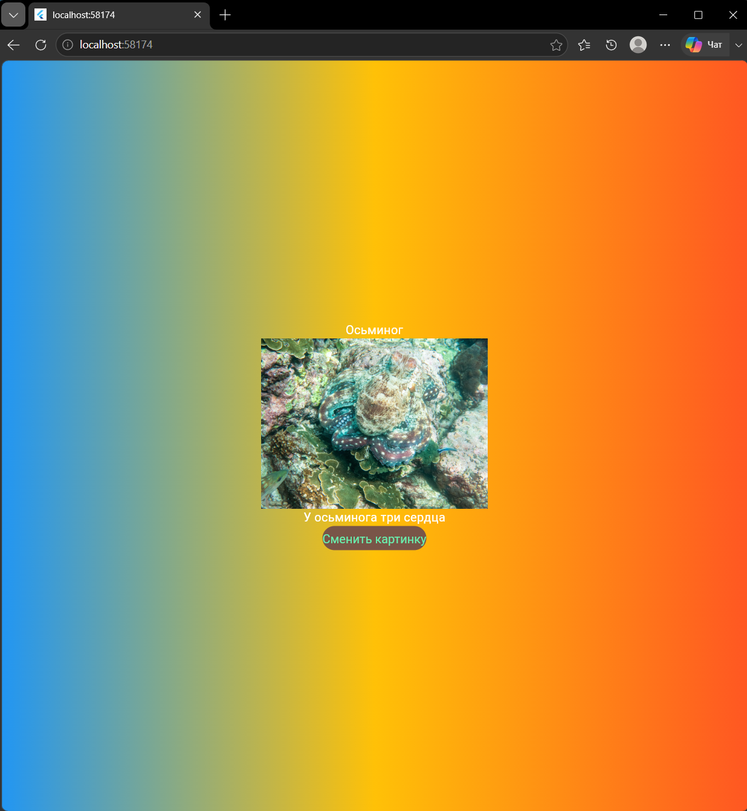

# Лабораторная работа №6. Flutter: самостоятельное приложение
Было создано Web-приложение котрое показывает один случайного животного и интересный факт о нём.

## Автор 
Дудаков Иван\
ИСП-241\
12.10.2026

## Стек и версии
* Flutter 3.47.2
* Dart 3.13.2
* Платформа: Web (Chrome, Edge)
* IDE: VS Code

## Скриншот приложения

## Структура проекта
lib/
* bg_gradient.dart - класс заднего фона приложения 
* main.dart - основной файл с точкой входа 
* styled_text.dart - класс стиля текста
* switch_img.dart - класс смены изображений и кнопки для их смены

## Как запустить
1. `git clone https://github.com/mirror344/Flutter_Lab6`
2. `cd Flutter_Lab6`
3. `flutter pub get`
4. `flutter run -d chrome`

## Что изучили
1. Создание классов-виджетов
2. Добавление изображения
3. StatefulWidget и управление состоянием виджета
4. Базовый класс виджетов StatelessWidget  
